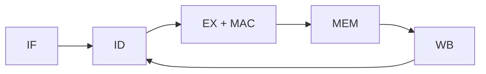

# RVX-MAT: RISC-V processor with a custom multiply–accumulate extension

RVX-MAT is a Verilog RTL project that extends an educational 32-bit RISC-V processor with custom instructions for dot-product style arithmetic. The repository includes single-cycle and five-stage pipeline implementations, simple instruction and data caches, and simulation testbenches comparing a scalar software multiplication program with the custom instruction path.

> **Scope:** This is a simulation-focused processor prototype. The included benchmark is a four-element dot product, not a complete matrix multiplication engine or an FPGA implementation.

## Highlights

- Five-stage datapath: instruction fetch (IF), decode (ID), execute (EX), memory (MEM), and write-back (WB).
- Custom `VCLR` and `VMAC` instructions decoded from the RISC-V custom-0 opcode (`0001011`).
- Signed 32 × 32-bit multiplication into a 64-bit accumulator; the low 32 bits are exposed for register write-back.
- EX/MEM and MEM/WB forwarding, load-use stalling, and branch/jump flushing in the pipeline RTL.
- Direct-mapped, 32-line instruction and data cache models with hit/miss outputs; the data cache has a write-through path.
- Benchmark and hazard testbenches that check register and memory results and report simulation cycles, instructions, and stalls.

## Architecture



The custom decoder recognizes these instruction fields:

| Instruction | Opcode | `funct3` | Behavior |
| --- | --- | --- | --- |
| `VMAC rd, rs1, rs2` | `0001011` | `000` | Accumulate signed `rs1 × rs2`; write the new accumulator's low 32 bits to `rd`. |
| `VCLR rd` | `0001011` | `010` | Clear the accumulator and write zero to `rd`. |

The 64-bit accumulator belongs to the MAC unit. The custom result is 32 bits at the register interface, so programs must account for truncation when the accumulated value exceeds 32 bits.

## Repository layout

| Path | Contents |
| --- | --- |
| `rtl/top_pipeline.v` | Five-stage core with RVX-MAT execution and hazard handling |
| `rtl/top_single.v` | Basic single-cycle core |
| `rtl/top_scalar.v`, `rtl/top_rvxmat2.v` | Cache-backed scalar and RVX-MAT comparison cores |
| `rtl/rvxmat_decoder.v`, `rtl/mac_unit.v` | Custom instruction decode and accumulator |
| `rtl/icache.v`, `rtl/dcache.v`, `rtl/perf_counters.v` | Cache models and performance counters |
| `tb/top_pipeline_rvxmat_tb.v` | Pipeline benchmark and hazard checks |
| `tb/top_rvxmat_tb.v` | Cache-backed comparison benchmark |
| `benchmarks/` | Scalar, RVX-MAT, and hazard program hex images |
| `tb/` | Additional unit and integration testbenches |

## Run the simulations

Install [Icarus Verilog](https://steveicarus.github.io/iverilog/) (`iverilog` and `vvp`). Run these commands **from the repository root**, since the hex images are loaded using relative paths:

```sh
iverilog -g2012 -s top_pipeline_rvxmat_tb -o pipeline_rvxmat.vvp rtl/*.v tb/top_pipeline_rvxmat_tb.v
vvp pipeline_rvxmat.vvp
```

The pipeline testbench compares the scalar and RVX-MAT programs, checks their dot-product result (`3×4 + 5×6 + 7×1 + 2×9 = 67`), and runs a separate forwarding/load-use/custom-instruction hazard program. Look for `ALL CHECKS PASSED` at the end. It also writes `pipeline_rvxmat.vcd` for waveform inspection.

To run the cache-backed comparison:

```sh
iverilog -g2012 -s top_rvxmat_tb -o rvxmat.vvp rtl/*.v tb/top_rvxmat_tb.v
vvp rvxmat.vvp
```

This testbench reports cycles, instruction counts, instruction-cache hits/misses, and the final dot-product result. It writes `rvxmat.vcd`. The numbers describe these specific simulation programs and models; they are not hardware timing, power, or general workload speedup measurements.

## Benchmark method

The two program images in `benchmarks/` compute the same four-element dot product. The pipeline testbench monitors each program until its `ECALL` marker drains, counts cycles and dispatched instructions, then checks `x11 = 67` in both cores and the RVX-MAT accumulator. It prints an instruction-count ratio and cycle ratio based on those measurements. Use the commands above to obtain the exact figures for the checked-out version.

## Tools and topics

Verilog HDL · RISC-V RV32I concepts · custom instructions · processor datapaths · pipelining · forwarding and hazards · cache modeling · RTL simulation

## Limitations

The cache models expose backing memory on a miss without modeling realistic miss latency. The project does not include synthesis, FPGA measurements, or a complete standard ISA compliance suite. The custom operations accelerate accumulation in the included workload; they do not implement vector registers or whole-matrix operations.
